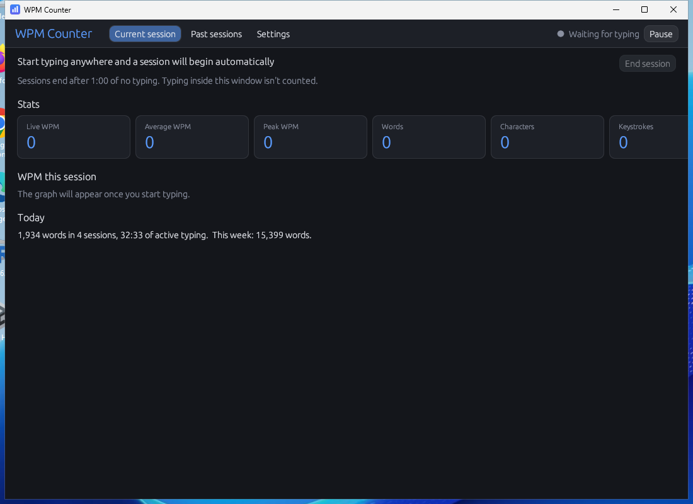
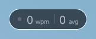
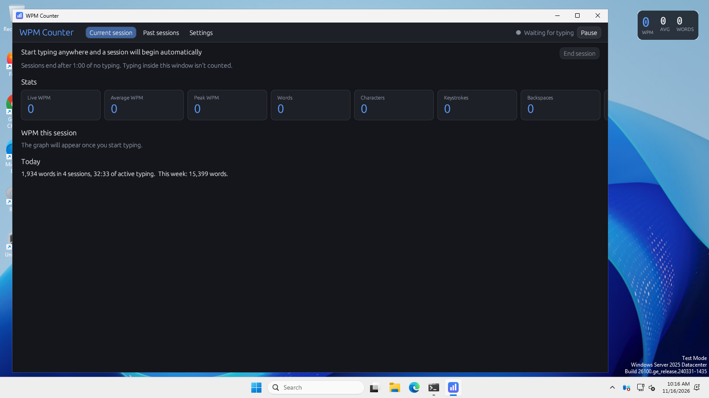

# WPM Counter

[](https://github.com/TheUthaGuy/wordsPerMinute/actions/workflows/screenshots.yml)

A Windows app that measures your typing speed everywhere you type. It doesn't use a test window: it counts your words per minute in any app. A small always-on-top overlay shows your live WPM, and a dashboard holds your history, charts and settings.

Written in Rust with [egui](https://github.com/emilk/egui).



<p align="center">
  
</p>

<details>
<summary>Full desktop view</summary>



</details>

> The screenshots are made automatically on a Windows VM by GitHub Actions, using generated demo data (see [Screenshots](#screenshots)).

## Features

- **Works in every app.** A low-level keyboard hook counts typing in any program, so you see how fast you really type.
- **Floating overlay.** A small click-through window that stays on top. You choose which stats it shows, its layout (horizontal tiles, vertical list or a compact line), colours, font size and position. You can pin it to a corner or drag it anywhere, and it can hide itself when you stop typing.
- **Dashboard** with three tabs:
  - **Current session:** live stat cards, a WPM graph for the session, and today's totals.
  - **Past sessions:** a summary, a WPM-over-time chart, and a sortable table of sessions you can rename or delete.
  - **Settings:** appearance, overlay, dashboard, session rules, hotkeys and data.
- **13 stats:** live, average and peak WPM, words, characters, keystrokes, backspaces, correction rate, session length, active typing time, words and time today, and all-time words.
- **Automatic sessions.** A session starts when you type and ends after a period with no typing (60 s by default). Pauses don't count against your average.
- **Themes.** Nine built-in themes (Midnight, Daylight, Arctic, Violet Night, Forest, Sand, Ocean, Ember, High Contrast). You can also make your own.
- **Tray icon** to open the dashboard, pause tracking, show or hide the overlay, end a session, or quit.
- **Global hotkeys**, which you can change.
- **Export** your sessions to CSV or JSON.

## Privacy

The app **never records what you type.** The keyboard hook only sorts each key press into one of three kinds (character, word separator or backspace) and notes the time. The key itself is never stored or sent anywhere, so your text can't be rebuilt from the data.

It also skips:
- synthetic (injected) key presses, such as those from macros or remote desktop tools
- typing inside the WPM Counter windows themselves

## How WPM is calculated

The app uses the standard definition: **one word = 5 characters**, spaces included.

| Stat | Meaning |
|---|---|
| Live WPM | Speed over a rolling window (10 s by default) |
| Average WPM | Session average, counting only active typing time |
| Peak WPM | Highest live WPM reached this session |
| Active time | Time spent typing. Gaps longer than 5 s (by default) are left out |

You can change all these timings under **Settings → Sessions**. Sessions with fewer than 25 typed characters are thrown away.

## Requirements

- Windows 10 or 11
- [Rust](https://rustup.rs/) (stable) to build it

The app uses Win32 APIs (keyboard hook, layered windows), so it only runs on Windows.

## Build and run

```powershell
git clone https://github.com/TheUthaGuy/wordsPerMinute.git
cd wordsPerMinute
cargo build --release
.\target\release\wpm-counter.exe
```

Release builds don't open a console window. Only one copy can run at a time; if you start a second one, it closes straight away.

To start it when you log in, put a shortcut to `wpm-counter.exe` in `shell:startup`.

## Usage

1. Start the app. The overlay shows up in the top-right corner, and the dashboard opens too.
2. Type in any other app. A session starts on its own and the overlay updates live.
3. Stop typing for a minute, or press **Ctrl+Alt+E**, to end and save the session.
4. Closing the dashboard doesn't quit the app. To reopen it, click the tray icon or press **Ctrl+Alt+D**. To quit, use the tray menu.

### Default hotkeys

| Hotkey | Action |
|---|---|
| `Ctrl+Alt+P` | Pause / resume tracking |
| `Ctrl+Alt+E` | End current session |
| `Ctrl+Alt+O` | Show / hide overlay |
| `Ctrl+Alt+D` | Open / close dashboard |

You can change them under **Settings → Hotkeys**. A hotkey needs Ctrl, Alt or Win, except F-keys, Pause and Scroll Lock, which work on their own.

### Moving the overlay

The overlay is locked (click-through) by default. To move it, either pick another corner under **Settings → Overlay**, or unlock it and drag it to where you want it.

## Data

Settings and sessions are saved as JSON files in:

```
%APPDATA%\WpmCounter\data\
├── settings.json
└── sessions.json
```

Files are written safely: a crash can't leave a half-written file behind. If a file can't be read, it's kept as `*.corrupt-<timestamp>` and not overwritten. **Settings → Data** has buttons to open this folder, export your sessions, or delete them all.

## Project layout

| File | Purpose |
|---|---|
| `src/main.rs` | Entry point, single-instance check, window setup |
| `src/app.rs` | App state, overlay drawing, main update loop |
| `src/dashboard.rs` | Dashboard window: Current / Past sessions / Settings tabs |
| `src/hook.rs` | System-wide keyboard hook (`WH_KEYBOARD_LL`) |
| `src/tracker.rs` | Session tracking and WPM calculations |
| `src/stats.rs` | Stat types and formatting |
| `src/settings.rs` | Settings model and defaults |
| `src/storage.rs` | Loading, saving and exporting JSON/CSV |
| `src/theme.rs` | Theme presets and egui styling |
| `src/hotkey.rs` | Hotkey parsing |
| `src/tray.rs` | System tray icon and menu |
| `src/icon.rs` | Generated app icon |

Run the tests with `cargo test`.

## Screenshots

The images in this README come from the [`Screenshots`](.github/workflows/screenshots.yml) GitHub Actions workflow, which runs on a `windows-latest` VM:

1. Builds the release exe.
2. Installs Mesa's software OpenGL renderer (llvmpipe), because the VM has no GPU.
3. Fills `%APPDATA%\WpmCounter\data` with a week of made-up sessions ([`seed-demo-data.ps1`](.github/scripts/seed-demo-data.ps1)).
4. Starts the app and captures the desktop, the dashboard and the overlay ([`screenshot.ps1`](.github/scripts/screenshot.ps1)).
5. Commits the PNGs to `docs/screenshots/` and uploads them as a build artifact.

It runs when the source changes on `main`. You can also start it by hand from the **Actions** tab (**Run workflow**).
